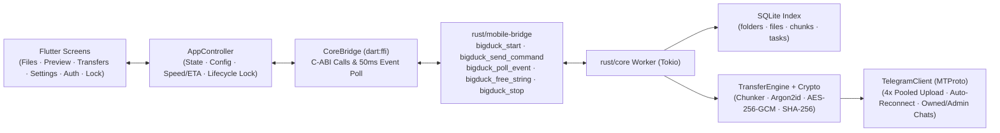

<div align="center">
  
  <h1>BIG DUCK — Signal Vault</h1>
  <p><strong>Zero-knowledge, client-side encrypted cloud storage over Telegram MTProto, powered by a bundled Rust native core and Flutter UI.</strong></p>

  <p>
    <a href="https://github.com/Ubb-a/big-duck-flutter/actions/workflows/build-mobile.yml">
      
    </a>
    <a href="https://github.com/Ubb-a/big-duck-flutter/releases/latest">
      
    </a>
  </p>
</div>

---

## Overview

**BIG DUCK — Signal Vault** turns your personal Telegram account (Saved Messages or a private group/channel you own or administer) into a private, zero-knowledge encrypted cloud drive—encrypting every file directly on your device before any byte leaves your phone.

The project uses a self-contained hybrid architecture with **no intermediary server**:
- **Flutter UI** implementing the **Signal Vault** design system (**Obsidian Luxury** dark & **Ivory Luxury** light themes, Arabic RTL primary + mirrored English LTR, inline darkroom previews for images/video/audio/PDF, and biometric/Face ID lock).
- **Bundled Rust Native Core** inside [`rust/`](rust/) invoked locally over `dart:ffi` (`cdylib` on Android, static `XCFramework`/archive on iOS).

---

## Key Features

- **Zero-Knowledge Client-Side Encryption:** Derives per-chunk keys with `Argon2id` and encrypts file chunks on-device using `AES-256-GCM`, paired with end-to-end `SHA-256` integrity verification on reassembly.
- **High-Throughput Native Rust MTProto Engine (`grammers-client`):**
  - **Parallel Multi-Connection Uploader:** Pools up to `4` MTProto connections and `8` concurrent `512 KiB` part workers with per-part retry and `FLOOD_WAIT` handling.
  - **Automatic Socket Recovery:** Detects mobile OS socket drops (including iOS `ENOTCONN` / errno `57`) and transparently re-establishes the session socket.
  - **Chunked & Resumable Transfers:** Configurable chunk sizes (`64 MiB` default; `64 / 256 / 512 / 1024 MiB`), cooperative `Pause / Resume`, and live intra-chunk `%`, `MB/s`, and `ETA` telemetry.
- **Smart Storage Destination Picker:** Filters Telegram chats strictly to **Owned by me** groups/channels or chats with **Admin posting rights**, plus live search and one-tap private vault group/channel creation.
- **Encrypted Index & Local File Tree:** Full SQLite folder/file/chunk index (`0001_initial.sql`), global multi-folder search, batch multi-select (`Move / Rename / Download / Delete`), and encrypted index backup & restore (`teledrive_index.tdrvbak`).
- **Native Mobile Polish:** Face ID / fingerprint app lock (`local_auth`) with configurable auto-lock timeout, OS Share Sheet upload staging, background transfer notifications, PDF/image thumbnail caching, and a `#050506` Darkroom viewer for photos, PDFs, audio, and video.

---

## Architecture



| Layer / Path | Responsibility |
|---|---|
| `lib/` | Signal Vault Flutter UI, `AppController` state management & speed tracking, AR/EN localization, platform services (`local_auth`, notifications, thumbnails, share receiver), and the `CoreBridge` `dart:ffi` client. |
| `rust/core/` | Shared Rust engine: async SQLite database, `Argon2id + AES-256-GCM` encryption, parallel chunker with intra-chunk progress tracking, `Pause/Resume` queue manager, and multi-connection Telegram MTProto client. |
| `rust/mobile-bridge/` | Thin C-ABI wrapper (`cdylib` for Android, `staticlib` for iOS) translating JSON commands and streaming `BridgeEvent` updates to Dart. |
| `android/` & `ios/` | Native manifests, biometric & photo library permissions, Android Share Sheet intent handling, and Xcode `-force_load` linking configuration for `libteledrive_mobile_bridge.a`. |
| `.github/workflows/` | Automated GitHub Actions pipelines building release **Android APK** (`build-mobile.yml`) & unsigned **iOS IPA** (`Sideloadly` / `AltStore`) and publishing tagged GitHub Releases (`publish-release.yml`). |

---

## Project Structure

```text
big_duck/
├── .github/
│   └── workflows/
│       ├── build-mobile.yml               # CI: compiles Rust targets and builds APK + unsigned IPA
│       └── publish-release.yml            # Instant GitHub Release publisher from built artifacts
├── android/
│   └── app/
│       ├── build.gradle.kts               # Android SDK 37 & core library desugaring config
│       └── src/main/
│           ├── AndroidManifest.xml        # Biometric, notification, and share-intent configuration
│           ├── kotlin/com/example/big_duck/
│           │   └── MainActivity.kt        # Forwards ACTION_SEND / ACTION_SEND_MULTIPLE files to Flutter
│           └── res/                       # Uncropped adaptive icon layers & mipmap assets
├── ios/
│   ├── Podfile                            # iOS 15.0 deployment target & Swift compatibility settings
│   ├── Flutter/
│   │   ├── Debug.xcconfig                 # Links libteledrive_mobile_bridge.a (-force_load) & bigduck_* symbols
│   │   └── Release.xcconfig               # Linker flags preserving C-ABI symbols under dead-code stripping
│   └── Runner/
│       ├── Info.plist                     # NSFaceIDUsageDescription, photo library permissions & document types
│       ├── Assets.xcassets/AppIcon.appiconset/
│       └── include/
│           └── BigDuckCoreBridge.h        # C-ABI header for the bundled Rust bridge
├── assets/
│   ├── icon.png                           # Master 1024x1024 app icon
│   ├── icon_bg.png                        # Adaptive icon background gradient
│   ├── icon_fg.png                        # Adaptive icon foreground inside safe zone
│   ├── fonts/                             # IBMPlexSans / IBMPlexSansArabic / IBMPlexMono
│   └── icons/                             # Custom SVG vector icons
├── lib/
│   ├── main.dart                          # App entry point, session routing & background auto-lock observer
│   ├── l10n/
│   │   └── app_strings.dart               # Complete Arabic (RTL) & English (LTR) string table
│   ├── models/
│   │   └── core_models.dart               # DirectorySnapshot, FileRecord, Folder, StorageChat, BridgeEvent models
│   ├── state/
│   │   └── app_controller.dart            # Central controller, local preferences, live speed/ETA & FFI commands
│   ├── theme/
│   │   └── app_theme.dart                 # Obsidian & Ivory tokens, vaultMotion timings/curves & VaultHaptics
│   ├── utils/
│   │   └── format.dart                    # Byte, transfer speed, ETA & timestamp formatters + MIME helpers
│   ├── screens/
│   │   ├── auth_screen.dart               # 4-step Telegram MTProto login (API creds -> Phone -> 5-digit OTP -> 2FA)
│   │   ├── lock_screen.dart               # Full-bleed biometric / Face ID unlock screen
│   │   ├── files_screen.dart              # Vault browser, global search, filters, multi-select, list/grid views
│   │   ├── preview_screen.dart            # Pure black (#050506) Darkroom viewer for images, PDF, video & audio
│   │   ├── transfers_screen.dart          # Active / Completed / Failed transfer queue with speed, ETA & chunk tape
│   │   └── settings_screen.dart           # Security, destination selector, vault password, backup & theme switcher
│   ├── services/
│   │   ├── core_bridge.dart               # DynamicLibrary loader & JSON command/event loop over dart:ffi
│   │   ├── biometric_service.dart         # Biometric authentication wrapper via local_auth
│   │   ├── notification_service.dart      # Transfer progress & completion notifications
│   │   ├── share_receiver_service.dart    # Streams shared external files into the vault queue
│   │   └── thumbnail_service.dart         # Local thumbnail generation and cache for images & PDFs
│   └── widgets/
│       ├── app_icon.dart                  # SVG asset icon wrapper
│       ├── floating_tab_bar.dart          # Floating glass pill navigation bar (RTL-mirrored + active badge)
│       ├── storage_destination_sheet.dart # Owned/Admin chat browser & private vault creation sheet
│       ├── vault_motion_widgets.dart      # Parallax, staggered reveal, rolling counters, draw check, circular reveal
│       └── vault_surface.dart             # Liquid glass containers, pill buttons, progress bars & chunk tape
├── rust/
│   ├── Cargo.toml                         # Cargo workspace (core + mobile-bridge)
│   ├── Cargo.lock                         # Pinned dependency lockfile
│   ├── core/
│   │   ├── Cargo.toml                     # Core crates (excluding desktop keyring on Android/iOS)
│   │   ├── migrations/
│   │   │   └── 0001_initial.sql           # SQLite schema: folders, files, file_chunks, transfer_tasks
│   │   └── src/
│   │       ├── lib.rs                     # Public core exports
│   │       ├── worker.rs                  # Async core command/event actor loop on Tokio
│   │       ├── telegram.rs                # Pooled MTProto uploader, auto-reconnect, chat filter & vault creation
│   │       ├── chunker.rs                 # Chunk planner, intra-chunk live progress tracker & SHA-256 verifier
│   │       ├── crypto.rs                  # Argon2id key derivation & AES-256-GCM frame encryption/decryption
│   │       ├── queue.rs                   # Concurrent job queue with Pause/Resume & FLOOD_WAIT backoff
│   │       ├── backup.rs                  # Encrypted SQLite index export & restore via Saved Messages
│   │       ├── db.rs                      # Async SQLite repository helpers
│   │       ├── keyring_store.rs           # Session storage abstraction (OS keyring on desktop, app sandbox on mobile)
│   │       ├── models.rs                  # SQLite entity structs & task enums
│   │       └── error.rs                   # Error variants, FLOOD_WAIT parser & transient network classifier
│   └── mobile-bridge/
│       ├── Cargo.toml                     # Compiles cdylib (Android) & staticlib (iOS)
│       └── src/
│           ├── lib.rs                     # C-ABI exports: bigduck_{start,send_command,poll_event,free_string,stop}
│           └── protocol.rs                # Serde mappings between SidecarCommand / SidecarEvent and core types
├── scripts/
│   ├── build_android_rust.ps1             # Cross-compiles Android .so libraries on Windows (PowerShell)
│   ├── build_android_rust.sh              # Cross-compiles Android .so libraries on Linux / macOS / CI
│   └── build_ios_rust.sh                  # Builds iOS static library / XCFramework on macOS
├── test/
│   └── widget_test.dart                   # Widget & state regression suite (UI, RTL/LTR, OTP, live speed/ETA)
├── docs/
│   └── design-board/
│       ├── index.html                     # Obsidian & Ivory Signal Vault interactive design board (393x852)
│       └── motion.html                    # Motion specification & interactive prototype across 7 flows
├── DESIGN.md                              # Obsidian Luxury Dark & Ivory Luxury Light design token reference
├── MOTION.md                              # Complete vaultMotion spec, Flutter handoff table & CPU/GPU audit
├── pubspec.yaml                           # Flutter dependencies, fonts & app icon assets
├── .gitattributes                         # Enforces LF line endings for scripts, workflows, Rust & Dart
└── .gitignore                             # Excludes rust/target, jniLibs, build/, .apk, .ipa & secrets
```

---

## Encryption & Zero-Knowledge Security Model

- **Zero Backend Architecture:** The app ships with no external backend API, analytics tracker, or shared database. Your phone connects exclusively and directly to Telegram MTProto servers using your own credentials (`API ID`, `API Hash`, and phone session), with local credentials stored inside your device's sandboxed storage (`bigduck.db` and `teledrive.session`).
- **On-Device Chunk Encryption:** Before upload, every file uploaded via `FilesScreen` or the OS Share Sheet is recorded locally in SQLite and processed by `TransferEngine`. When a **Vault Password** is active, each chunk (`64 MiB` default) derives a unique 256-bit key using `Argon2id` with a fresh random 16-byte salt and encrypts via `AES-256-GCM` before leaving the device.
- **Integrity & Backup Recovery:** Uploaded chunk message IDs (`telegram_message_id`) and full-file `SHA-256` checksums are persisted locally, and you can back up or restore your entire encrypted folder index (`teledrive_index.tdrvbak`) directly through your selected Telegram vault chat.

---

## Releases, CI & Local Builds

### 1. Prebuilt Releases (`APK` & `IPA`)

Download ready-to-install builds directly from the [GitHub Releases](https://github.com/Ubb-a/big-duck-flutter/releases/latest) page:
- **Android (`BIG-DUCK-android.apk`)** — Universal release APK (`arm64-v8a`, `armeabi-v7a`, `x86_64`).
- **iOS (`BIG-DUCK-ios.ipa`)** — Unsigned iOS release archive ready for sideloading via **Sideloadly**, **AltStore**, or **SideStore**.

### 2. GitHub Actions CI & Tag Publishing

Every code push to `main` runs `.github/workflows/build-mobile.yml` to compile native Rust binaries for both platforms and produce fresh `BIG-DUCK-android-apk` and `BIG-DUCK-ios-ipa` artifacts in the [Actions](https://github.com/Ubb-a/big-duck-flutter/actions) tab.

To package the latest verified build artifacts into a GitHub Release without rebuilding from scratch:

```bash
git tag -a v1.0.1 -m "BIG DUCK — Signal Vault v1.0.1"
git push origin v1.0.1
```

### 3. Local Testing & Builds

#### Rust Workspace Tests (offline)
```powershell
# Windows with MSYS2 UCRT64 toolchain:
$env:PATH = "C:\msys64\ucrt64\bin;$env:PATH"
cargo +stable-x86_64-pc-windows-gnu test --manifest-path .\rust\Cargo.toml --workspace
```

#### Flutter Analysis & Widget Tests
```powershell
flutter pub get
flutter analyze
flutter test
```

#### Android APK (Windows PowerShell)
```powershell
powershell -ExecutionPolicy Bypass -File .\scripts\build_android_rust.ps1
flutter pub get
flutter build apk --release
```

#### iOS IPA (macOS + Xcode)
```bash
chmod +x ./scripts/build_ios_rust.sh
./scripts/build_ios_rust.sh --device-only
flutter pub get
flutter build ios --release --no-codesign
```
