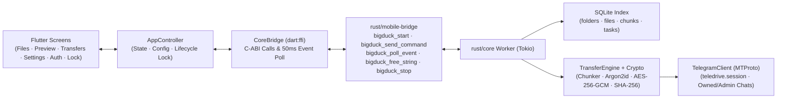

<div align="center">
  
  <h1>BIG DUCK — Signal Vault</h1>
  <p><strong>خزنة سحابية مشفرة بالكامل على جهازك فوق تيليجرام، بمحرك Rust مدمج وواجهة Flutter</strong></p>
  <p><em>Client-side zero-knowledge encrypted cloud storage backed by Telegram MTProto, a bundled Rust native core, and a bilingual Flutter UI.</em></p>

  <p>
    <a href="https://github.com/Ubb-a/big-duck-flutter/actions/workflows/build-mobile.yml">
      
    </a>
  </p>
</div>

---

## نظرة عامة | Overview

**BIG DUCK** يحوّل حسابك على تيليجرام (Saved Messages أو جروب/قناة خاصة بك) إلى مساحة تخزين سحابية خاصة بك ومشفرة محلياً قبل مغادرة أي بايت لجهازك.

يعتمد المشروع على معمارية هجينة تجمع بين:
- **Flutter UI** بهوية **Signal Vault** (عربي RTL / إنجليزي LTR، وضع فاتح وداكن وتلقائي، معاينة صور وفيديو وصوت وPDF، قفل بالبصمة/Face ID).
- **Rust Native Core** مدمج داخل المستودع في [`rust/`](rust/) يعمل عبر `dart:ffi` مباشرة داخل التطبيق بدون سيرفر خارجي.

---

## المميزات الرئيسية | Key Features

- **تشفير محلي قبل الرفع (Zero-Knowledge Client-Side Crypto):** اشتقاق المفتاح عبر `Argon2id` وتشفير الأجزاء بـ `AES-256-GCM` مع التحقق من سلامة الملفات ببصمة `SHA-256`.
- **محرك MTProto أصيل بالـ Rust (`grammers-client`):**
  - حفظ جلسة تسجيل الدخول ذرياً على القرص (`teledrive.session`) على Android وiOS دون طلب رمز التحقق مع كل تشغيل.
  - تقسيم الملفات الكبيرة تلقائياً (`64 / 256 / 512 / 1024 MiB`)، دعم **الإيقاف المؤقت والاستكمال (`Pause / Resume`)**، ومعالجة `FLOOD_WAIT` تلقائياً.
- **اختيار ذكي لوجهة التخزين:** فلترة الجروبات والقنوات لتظهر فقط **المملوكة لك (`Owned by me`)** أو التي تملك فيها **صلاحية نشر إدارية (`Admin access`)**، مع بحث فوري وإنشاء جروب أو قناة خزنة خاصة بضغطة واحدة.
- **فهرسة محلية ونسخ احتياطي مشفّر:** شجرة مجلدات كاملة داخل SQLite (`0001_initial.sql`)، بحث شامل عبر كل المجلدات، تحديد متعدد (`Move / Rename / Download / Delete`)، ونسخ/استعادة الفهرس المشفّر (`teledrive_index.tdrvbak`).
- **تجربة موبايل متكاملة:** قفل بالبصمة أو Face ID (`local_auth`)، استقبال الملفات عبر Android Share Sheet، إشعارات تقدم الرفع والتنزيل في الخلفية، مصغّرات الصور وPDF، وعارض Darkroom مدمج للصور وPDF والفيديو والصوت.

---

## معمارية التطبيق | Architecture



| الطبقة / المسار | الدور المسؤول عنه |
|---|---|
| `lib/` | واجهة المستخدم، إدارة الحالة (`AppController`)، الترجمة العربية/الإنجليزية، الخدمات المحلية (`local_auth`, `notifications`, `thumbnails`, `share_receiver`)، وجسر `CoreBridge` عبر `dart:ffi`. |
| `rust/core/` | النواة المشتركة: قاعدة بيانات SQLite، تشفير `Argon2id + AES-256-GCM`، تقسيم الملفات واستكمالها، طابور التحويلات المتوازي، والاتصال بـ Telegram MTProto. |
| `rust/mobile-bridge/` | طبقة C-ABI (`cdylib` لأندرويد و`staticlib` للآيفون) لاستقبال أوامر JSON ودفع أحداث `BridgeEvent` إلى Flutter. |
| `android/` و `ios/` | تهيئة أذونات البصمة والإشعارات واستقبال المشاركة على أندرويد، وإعداد `Podfile` و`xcconfig` لربط `libteledrive_mobile_bridge.a` في iOS. |
| `.github/workflows/` | بناء تلقائي لملف **Android APK** وملف **iOS IPA** غير الموقّع (لـ Sideloadly / AltStore) على GitHub Actions. |

---

## هيكل المشروع بالتفصيل | Project Structure

```text
big_duck/
├── .github/
│   └── workflows/
│       └── build-mobile.yml               # CI: بناء BIG-DUCK-android.apk و BIG-DUCK-ios.ipa + Releases
├── android/
│   └── app/
│       ├── build.gradle.kts               # إعدادات compileSdk 37 و Core Library Desugaring
│       └── src/main/
│           ├── AndroidManifest.xml        # أذونات البصمة والإشعارات ومستقبل المشاركة
│           ├── kotlin/com/example/big_duck/
│           │   └── MainActivity.kt        # استقبال ACTION_SEND / ACTION_SEND_MULTIPLE وتمريره لـ Flutter
│           └── res/                       # أيقونات Adaptive Icon غير مقصوصة ومقاسات mipmap
├── ios/
│   ├── Podfile                            # iOS 15.0 deployment target + Swift compatibility
│   ├── Flutter/
│   │   ├── Debug.xcconfig                 # ربط libteledrive_mobile_bridge.a (-force_load) ورموز bigduck_*
│   │   └── Release.xcconfig               # إعدادات الربط ومنع Dead Code Stripping للرموز
│   └── Runner/
│       ├── Info.plist                     # NSFaceIDUsageDescription + Document types
│       ├── Assets.xcassets/AppIcon.appiconset/
│       └── include/
│           └── BigDuckCoreBridge.h        # ترويسة دوال C-ABI للباك إند
├── assets/
│   ├── icon.png                           # أيقونة التطبيق الكاملة (1024×1024)
│   ├── icon_bg.png                        # خلفية التدرج السماوي للـ Adaptive Icon
│   ├── icon_fg.png                        # الطبقة الأمامية داخل منطقة الأمان 66%
│   ├── fonts/                             # خطوط IBMPlexSans / IBMPlexSansArabic / IBMPlexMono
│   └── icons/                             # أيقونات SVG مخصصة للتطبيق
├── lib/
│   ├── main.dart                          # نقطة التشغيل، توجيه الجلسة المحفوظة، ومراقبة قفل الخلفية
│   ├── l10n/
│   │   └── app_strings.dart               # نصوص الواجهة الكاملة بالعربية والإنجليزية
│   ├── models/
│   │   └── core_models.dart               # نماذج DirectorySnapshot, FileRecord, Folder, StorageChat, BridgeEvent
│   ├── state/
│   │   └── app_controller.dart            # الحالة الرئيسية، حفظ الإعدادات/الجلسة، الأوامر والأحداث
│   ├── theme/
│   │   └── app_theme.dart                 # ألوان Obsidian & Ivory Signal Vault وأزمنة الحركة 250ms (vaultMotion)
│   ├── utils/
│   │   └── format.dart                    # تنسيق الأحجام والأوقات وكشف أنواع الملفات
│   ├── screens/
│   │   ├── auth_screen.dart               # ربط Telegram من 4 خطوات مع تبديل اللغة السريع
│   │   ├── lock_screen.dart               # شاشة القفل بالبصمة / Face ID
│   │   ├── files_screen.dart              # متصفح الخزنة، البحث الشامل، التصفية، التحديد المتعدد، العرض الشبكي
│   │   ├── preview_screen.dart            # معاينة الصور (Darkroom #050506)، PDF، الفيديو، والصوت
│   │   ├── transfers_screen.dart          # قائمة التحويلات المباشرة مع الإيقاف والاستكمال
│   │   └── settings_screen.dart           # الحساب والأمان، اختيار/إنشاء جروب التخزين، التشفير والنسخ الاحتياطي
│   ├── services/
│   │   ├── core_bridge.dart               # تحميل المكتبة الأصلية عبر dart:ffi وجسر JSON-RPC
│   │   ├── biometric_service.dart         # التحقق الحيوي عبر local_auth
│   │   ├── notification_service.dart      # إشعارات نسبة الرفع والتنزيل عبر flutter_local_notifications
│   │   ├── share_receiver_service.dart    # استقبال الملفات المشتركة من تطبيقات أندرويد
│   │   └── thumbnail_service.dart         # توليد وكاش مصغرات الصور وصفحة PDF الأولى
│   └── widgets/
│       ├── app_icon.dart                  # عارض أيقونات SVG
│       ├── floating_tab_bar.dart          # شريط التنقل العائم الدائري مع دعم RTL وعداد التحويلات النشطة
│       ├── storage_destination_sheet.dart # نافذة اختيار وإنشاء جروبات وقنوات الخزنة المملوكة
│       └── vault_surface.dart             # مكونات الزجاج السائل Obsidian & Ivory (أزرار، أشرطة تقدم، شرائح)
├── rust/
│   ├── Cargo.toml                         # Workspace يضم core و mobile-bridge
│   ├── Cargo.lock                         # تثبيت إصدارات الحزم
│   ├── core/
│   │   ├── Cargo.toml                     # اعتماديات النواة (excluding desktop keyring on Android/iOS)
│   │   ├── migrations/
│   │   │   └── 0001_initial.sql           # جداول folders, files, file_chunks, transfer_tasks
│   │   └── src/
│   │       ├── lib.rs                     # تصدير وحدات النواة
│   │       ├── worker.rs                  # حلقة المعالجة الخلفية وإدارة الأوامر CoreCommand / CoreEvent
│   │       ├── telegram.rs                # عميل MTProto، حفظ الجلسة، فلترة الجروبات المملوكة، إنشاء خزنة
│   │       ├── chunker.rs                 # تقسيم الأجزاء وتشفيرها/فك تشفيرها والتحقق بـ SHA-256
│   │       ├── crypto.rs                  # اشتقاق المفاتيح Argon2id والتشفير AES-256-GCM
│   │       ├── queue.rs                   # طابور المهام المتوازي مع Pause/Resume و FloodWait retry
│   │       ├── backup.rs                  # نسخ الفهرس المشفر واستعادته عبر تيليجرام
│   │       ├── db.rs                      # عمليات SQLite غير المتزامنة
│   │       ├── keyring_store.rs           # تخزين بيانات الجلسة (سطح المكتب مقابل sandbox الموبايل)
│   │       ├── models.rs                  # نماذج SQLite وحالات المهام
│   │       └── error.rs                   # تعريف الأخطاء وكشف FloodWait
│   └── mobile-bridge/
│       ├── Cargo.toml                     # بناء cdylib (Android) و staticlib (iOS)
│       └── src/
│           ├── lib.rs                     # تصدير دوال FFI: bigduck_{start,send_command,poll_event,free_string,stop}
│           └── protocol.rs                # تحويل SidecarCommand / SidecarEvent بين JSON و Core
├── scripts/
│   ├── build_android_rust.ps1             # بناء مكتبات Android .so على Windows (PowerShell)
│   ├── build_android_rust.sh              # بناء مكتبات Android .so على Linux / macOS / CI
│   └── build_ios_rust.sh                  # بناء libteledrive_mobile_bridge.a / BigDuckCore.xcframework على macOS
├── test/
│   └── widget_test.dart                   # اختبارات الواجهة، التصفية، المعاينة، حفظ الجلسة، واختيار الوجهة
├── docs/
│   └── design-board/
│       └── index.html                     # لوحة نظام التصميم التفاعلية (Obsidian & Ivory Signal Vault · 393×852)
├── DESIGN.md                              # دليل نظام التصميم المحدّث (Obsidian Luxury Dark & Ivory Luxury Light)
├── pubspec.yaml                           # اعتماديات Flutter وخطوط وأصول الأيقونات
├── .gitattributes                         # توحيد LF لملفات .sh و .yml و .rs و .dart
└── .gitignore                             # استبعاد rust/target و jniLibs و build/ وملفات Apk/Ipa المولّدة
```

---

## تدفّق التشفير والتخزين | Encryption & Storage Flow

1. عند رفع ملف من `FilesScreen` (أو عبر المشاركة من تطبيق آخر)، يُسجَّل في SQLite ويُرسل إلى `TransferEngine` في Rust.
2. يُقسَّم الملف حسب `chunkSizeMiB` (`64` إلى `1024 MiB`)؛ وإذا كانت كلمة مرور الخزنة مفعّلة، يُشتق مفتاح بـ `Argon2id` ويُشفَّر كل جزء بـ `AES-256-GCM` على الجهاز قبل إرساله إلى وجهة التخزين المختارة (الرسائل المحفوظة أو جروب/قناة خاصة بك).
3. يُحفظ كل معرف رسالة (`telegram_message_id`) وبصمة `SHA-256` في جدول `file_chunks`، مع إمكانية رفع نسخة مشفرة من قاعدة الفهرس (`teledrive_index.tdrvbak`) واستعادتها في أي وقت.

---

## التشغيل والبناء | CI & Local Builds

### 1. البناء والتحميل من GitHub Actions (`APK` و `IPA`)

بمجرد الدفع إلى `main` (أو تشغيل الـ Workflow يدوياً من تبويب **Actions**):
- صفحة الـ Actions: <https://github.com/Ubb-a/big-duck-flutter/actions>
- **للأندرويد:** حمّل Artifact باسم **`BIG-DUCK-android-apk`** لتحصل على `BIG-DUCK-android.apk`.
- **للآيفون/آيباد:** حمّل Artifact باسم **`BIG-DUCK-ios-ipa`** لتحصل على `BIG-DUCK-ios.ipa` ثم ثبّته عبر **Sideloadly** أو **AltStore** أو **SideStore**.
- ولنشر إصدار رسمي في **Releases** مرفق بالملفين تلقائياً:

```powershell
git tag v1.0.0
git push origin v1.0.0
```

### 2. البناء والاختبار محلياً

#### اختبارات Rust (بدون اتصال إنترنت)
```powershell
# على Windows بوجود MSYS2 UCRT64:
$env:PATH = "C:\msys64\ucrt64\bin;$env:PATH"
cargo +stable-x86_64-pc-windows-gnu test --manifest-path .\rust\Cargo.toml --workspace
```

#### Android APK (Windows)
```powershell
powershell -ExecutionPolicy Bypass -File .\scripts\build_android_rust.ps1
flutter pub get
flutter analyze
flutter test
flutter build apk --release
```

#### iOS IPA (macOS + Xcode)
```bash
chmod +x ./scripts/build_ios_rust.sh
./scripts/build_ios_rust.sh --device-only
flutter pub get
flutter build ios --release --no-codesign
```
